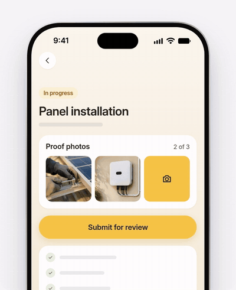
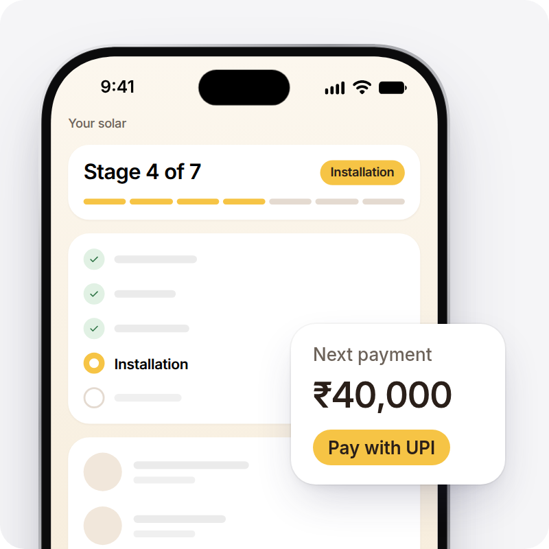
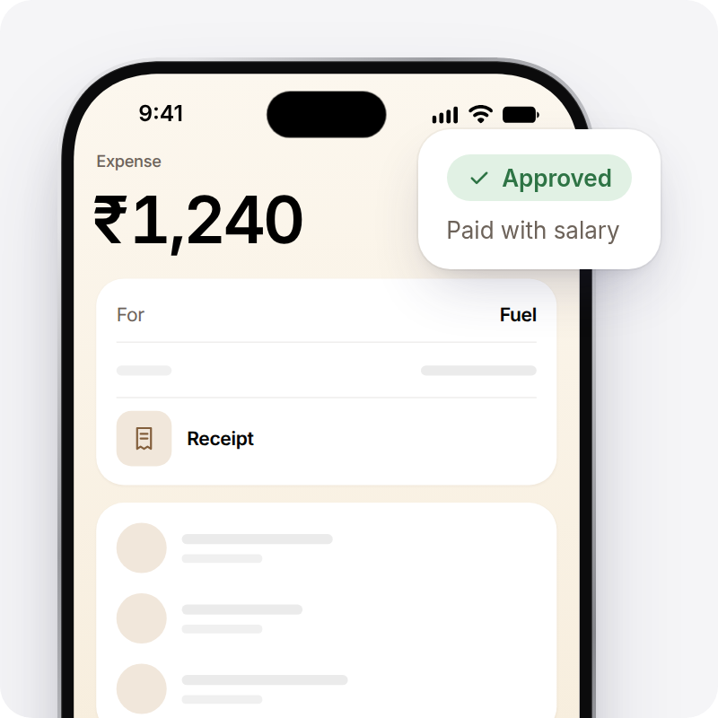
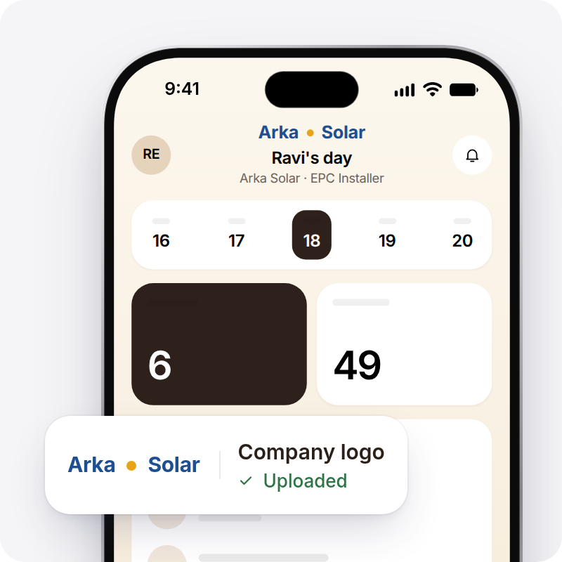
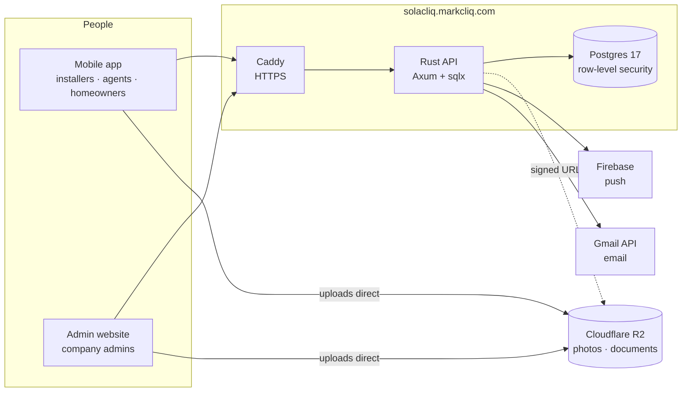

<div align="center">

<picture>
  <source media="(prefers-color-scheme: dark)" srcset="design/logo/kit/svg/solacliq-lockup-horizontal-dark.svg">
  
</picture>

### Every solar install, in one place.

The app for solar EPC companies, their field teams and their customers.<br>
By [MarkCliq](https://markcliq.com).


<br>


<sub>Illustrative screens, sample data. "Arka Solar" is an example company.</sub>

</div>

<br>

## What it is

A solar EPC runs on people who are rarely in the same place: the owner in
the office, installers on roofs, sales agents in the field, and homeowners
waiting to hear what happens next. Today that lives in WhatsApp groups,
phone calls and a spreadsheet someone forgot to update.

SolaCliq puts it in one app. Every customer moves through the same seven
stages, every step on the roof has a GPS-tagged photo behind it, every
rupee spent or owed is logged and approved, and every homeowner can see
where their install is without calling the office.

```
lead → site survey → quote → subsidy paperwork → install → net metering → service
```

<br>

## Built for four people

| Who | Where | What they do |
|---|---|---|
| **Company admin** | Admin website | Sees the whole company, sets up the team, assigns work, approves photos, expenses and commissions |
| **Installer** | Mobile app | Their tasks for the day, proof photos with GPS, checklists, expenses with the receipt |
| **Sales agent** | Mobile app | Registers customers with their KYC, follows them through the stages, logs commission |
| **Homeowner** | Mobile app | Their install's stage, the full cost breakdown, payments by UPI or bank transfer |

One account per person, across companies: an installer who works for two
EPCs switches between them inside the app.

<br>

## A look inside

<table>
  <tr>
    <td width="44%" valign="top">
      
    </td>
    <td valign="middle">
      <h3>Proof photos, from the roof</h3>
      <p>Installers shoot each step on site. Every photo carries its GPS
      position and goes straight to the admin, who approves it from the
      office. The installer gets a push notification and moves on to the
      next task.</p>
      <p>No more "send me a photo on WhatsApp". No more wondering whether
      the inverter was really mounted on Tuesday.</p>
    </td>
  </tr>
</table>

<table>
  <tr>
    <td width="33%" valign="top" align="center">
      
      <h4>Homeowners see every stage</h4>
      <sub>From site survey to handover, and what to pay next, without calling the office.</sub>
    </td>
    <td width="33%" valign="top" align="center">
      
      <h4>Expenses with the receipt</h4>
      <sub>Fuel, tools, travel: logged from the field with a photo of the bill, approved from the office.</sub>
    </td>
    <td width="33%" valign="top" align="center">
      
      <h4>Your logo, your team's app</h4>
      <sub>The company uploads its logo once. Every installer, agent and customer sees it.</sub>
    </td>
  </tr>
</table>

<div align="center"><sub>Illustrative screens, sample data. Graphics built with <a href="https://github.com/benjitaylor/skills">Stageshow</a>, in the app's own design; see <a href="marketing/README.md"><code>marketing/</code></a>.</sub></div>

<br>

## How it fits together



- **One API contract** (`api/openapi.yaml`) shared by all three parts. The
  Dart and TypeScript clients are generated from it, and CI fails if they
  fall out of date.
- **Each company's data is walled off in the database itself.** The API
  logs in as a role that row-level security restricts to the company of
  each request, so a query that forgets its filter still sees nothing
  else.
- **Files never pass through the server.** The API signs a short-lived
  URL for one file of one type and size; the phone uploads straight to R2.
- **Money is integer paise everywhere.** No floats, anywhere.

<br>

## The stack

| Part | Built with |
|---|---|
| Mobile app | Flutter (Dart), Android first, Inter, the "iOS v2" design |
| Admin website | React, Vite, TypeScript, a static site |
| Backend | Rust, Axum, sqlx, utoipa for the OpenAPI spec |
| Database | Postgres 17, row-level security per company |
| Files | Cloudflare R2, private bucket, presigned URLs |
| Push and email | Firebase Cloud Messaging, the Gmail API |
| Updates (planned) | Shorebird over-the-air patches, self-hosted APK for the pilot |

<br>

## The repo

| Folder | What's in it |
|---|---|
| [`api/`](api/) | The OpenAPI contract every part builds against, plus a Postman collection |
| [`backend/`](backend/) | The Rust API, its migrations and tests |
| [`mobile/`](mobile/) | The Flutter app, its design-system package `sola_ui` and the generated API client |
| [`admin/`](admin/) | The React admin website |
| [`design/`](design/) | Design tokens (one source for both apps), the logo kit and the app's screen designs |
| [`marketing/`](marketing/) | Website graphics and the promo videos |
| [`deploy/`](deploy/) | Caddy, systemd and backup files for the VPS |
| [`docs/`](docs/) | The record: product, architecture, features, decisions, data policy |

<br>

## Where things stand

The worker, sales and customer flows run end to end in the app against the
real API, along with push notifications and company logos. Next: the first
deploy, then the admin website's screens, referrals and in-app updates.
Pilot vendor: RY Enterprises, Bhadrak.

Feature by feature, with status: [`docs/features.md`](docs/features.md).

<br>

## Read more

| Doc | What it covers |
|---|---|
| [`docs/product.md`](docs/product.md) | What the product does, the roles and the rules |
| [`docs/architecture.md`](docs/architecture.md) | Stack, hosting, the API contract and its conventions |
| [`docs/features.md`](docs/features.md) | Every feature, build order and status |
| [`docs/decisions.md`](docs/decisions.md) | Dated log of decisions and why |
| [`docs/data-policy.md`](docs/data-policy.md) | How customer data is kept apart, stored, encrypted and deleted |
| [`design/logo/kit/GUIDELINES.md`](design/logo/kit/GUIDELINES.md) | Using the SolaCliq logo |

Each part has its own `CLAUDE.md` with its rules and how to run it.

<br>

<div align="center">


<sub>SolaCliq is built by <a href="https://markcliq.com">MarkCliq</a>: performance marketing, custom software, intelligent automation.</sub>

</div>
